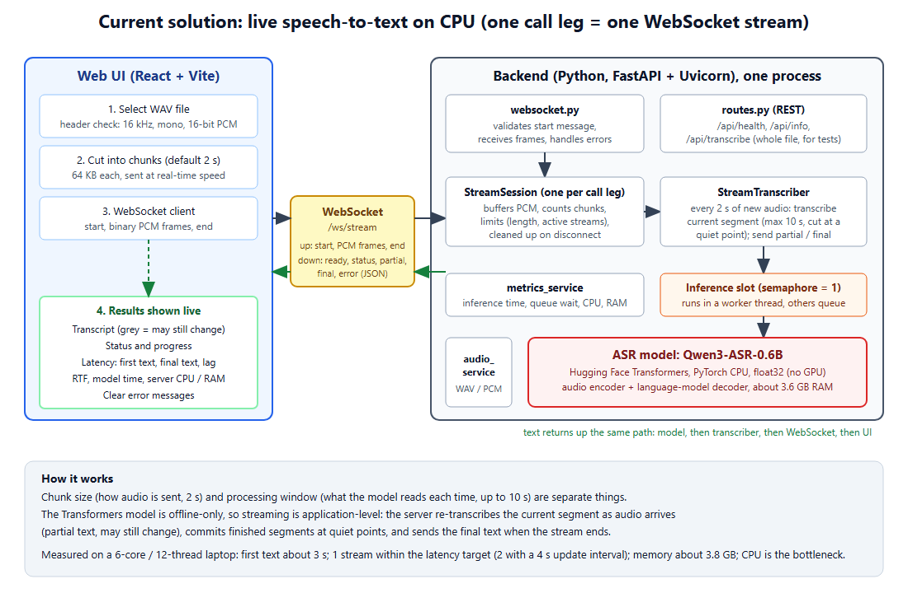

# Live speech-to-text on CPU (Qwen3-ASR)

A small end-to-end web application that behaves like **one live voice-call leg**: you pick a 16 kHz mono WAV file, the browser sends it to a backend in
small chunks at real-time speed over a WebSocket, the backend transcribes it with **Qwen3-ASR running on the CPU only**, and the transcript and latency figures
appear in the page while the audio is still being sent. English, Mandarin Chinese and Bahasa Indonesia were tested.

Built for the Tetherfi fresher technical assignment. Measured results, estimates and limitations are in [`reports/`](reports/) (start with the
[technical report](reports/technical_report.md)). Architecture diagrams: [`architecture/architecture.png`](architecture/architecture.png) (current) and
[`architecture/scaling.png`](architecture/scaling.png) (proposed scaling design).



## Technology choices
| Part | Choice | Why |
|---|---|---|
| Frontend | React + Vite + Tailwind CSS | Familiar, quick to build; the audio streaming logic is plain JavaScript modules, so it can be tested without a browser |
| Backend | Python + FastAPI + Uvicorn | The Qwen3-ASR / PyTorch ecosystem is Python; FastAPI supports REST and WebSockets in one app |
| Streaming | WebSocket (binary PCM frames + JSON control messages) | One persistent two-way connection per call leg: audio up, transcript and status down |
| ASR | `Qwen/Qwen3-ASR-0.6B-hf` with Hugging Face Transformers, PyTorch CPU, float32 | Required model; the smaller 0.6B variant; the only route that I could run on a CPU-only Windows machine |
| Measurement | psutil, jiwer | CPU/RAM sampling, WER/CER |

**Streaming approach (important):** the Transformers backend of Qwen3-ASR has no native streaming (the official streaming mode uses vLLM, which does not run natively on
Windows and has no confirmed CPU support). So this is **application-level streaming**: the browser sends 2 s chunks, the backend buffers them and re-transcribes the
current segment every 2 s of new audio (partial text, may still change), commits a segment at a quiet point once it reaches 10 s, and sends a final transcript at the end.
It is *not* native incremental inference. The audio **chunk size** (how data is sent, default 2 s = 64 KB) and the **processing window** (what the model reads, up to 10 s) are separate settings.

## Prerequisites
- Windows 10/11 (tested on Windows 11; other systems are untested). A CPU is enough, no GPU is used (it is hidden from PyTorch on purpose).
- Python 3.12+ (tested with 3.13) and Node.js 20+ (tested with 22).
- About 8 GB free RAM (the model uses about 3.6-4 GB) and about 3 GB disk for the model download. Internet access on the first run.
- Optional: ffmpeg, to convert your own audio to the required format.

## Install
```powershell
# 1. Backend
cd backend
python -m venv .venv
.venv\Scripts\Activate.ps1
pip install torch==2.15.0 --index-url https://download.pytorch.org/whl/cpu
pip install -r requirements.txt

# 2. Frontend (new terminal)
cd frontend
npm install
```

**Model download:** nothing to do manually. The first backend start downloads `Qwen/Qwen3-ASR-0.6B-hf` from Hugging Face into the Hugging Face cache
(default `C:\Users\<you>\.cache\huggingface`). To keep it on another drive set `HF_HOME` before starting, for example `$env:HF_HOME = "D:\hf_cache"`.
The first start can take several minutes; later starts take about 6 s.

## Run
```powershell
# Terminal 1: backend  (wait for "Model loaded in ... s")
cd backend
.venv\Scripts\Activate.ps1
uvicorn app.main:app --port 8000

# Terminal 2: frontend
cd frontend
npm run dev
```
Open **http://localhost:5173**. The badge in the top right turns green ("Backend ready") when the model is loaded.

**Demo:** choose a file from [`samples/`](samples/) (`english.wav`, `mandarin.wav`, `indonesian.wav` are real recordings; `*_tts.wav` are synthetic speech),
pick the language (or Auto-detect) and a chunk size, and press **Start streaming**. You will see the transcript grow (grey italic text may still change),
the progress of audio sent, first-text and final latency, and, once finished, the real-time factor, model time and server CPU / RAM.
Files that are not 16 kHz mono 16-bit PCM WAV are rejected with a message that includes the ffmpeg command to convert them:
`ffmpeg -i input.wav -ar 16000 -ac 1 -c:a pcm_s16le output.wav`

## API summary
| Endpoint | Purpose |
|---|---|
| `GET /api/health` | model loaded?, load time, active streams |
| `GET /api/info` | expected audio format, languages |
| `POST /api/transcribe` | whole-file transcription (multipart `file`, optional `language`); for testing, not streaming |
| `WS /ws/stream` | the streaming endpoint (below) |

WebSocket protocol: client sends JSON `{"type":"start","language":"auto|English|Chinese|Indonesian","sample_rate":16000,"channels":1,"chunk_ms":2000}`;
server answers `{"type":"ready"}`; client sends binary frames of raw 16-bit little-endian mono PCM; server sends `status` after each frame and `partial` transcripts;
client sends `{"type":"end"}`; server sends `final` (text, latency, RTF, CPU, RAM) and closes. Any problem produces `{"type":"error","code":...,"message":...}` and a close.
Error codes include `bad_sample_rate`, `bad_language`, `bad_json`, `server_busy`, `stream_too_long`, `model_unavailable`, `asr_failed`.

## Configuration (environment variables for the backend)
| Variable | Default | Meaning |
|---|---|---|
| `ASR_MODEL_ID` | `Qwen/Qwen3-ASR-0.6B-hf` | model to load |
| `ASR_MAX_CONCURRENT_INFERENCES` | 1 | model runs allowed at the same time |
| `ASR_TORCH_THREADS` | 0 (torch default) | CPU threads per inference |
| `ASR_UPDATE_INTERVAL_S` | 2.0 | new audio needed before the next partial transcript |
| `ASR_MAX_SEGMENT_S` | 10.0 | a segment is committed once it reaches this length |
| `ASR_MAX_STREAMS` / `ASR_MAX_STREAM_SECONDS` | 20 / 600 | simultaneous streams / audio per stream |
| `ASR_CORS_ORIGINS` | `http://localhost:5173,http://127.0.0.1:5173` | allowed browser origins |
Frontend: `VITE_API_URL` (default `http://localhost:8000`).

## Tests and experiments
Run from the project root with the backend venv active (`pip install -r backend/requirements.txt` includes the test tools).
| Command | What it checks | Needs a running backend? |
|---|---|---|
| `python -m pytest tests/test_stream_transcriber.py -q` | streaming logic with a fake model (segments, no lost audio, failure handling) | no |
| `python tests/test_ws_protocol.py` | 12 WebSocket protocol / error cases | yes (`:8000`) |
| `node tests/frontend_check.mjs` | WAV parser, streamer and state logic against the live backend | yes (`:8000`) |
| `node tests/failure_check.mjs` | server killed mid-stream, model cannot load | no (starts its own on 8003/8004) |
| `python tests/stream_client.py samples/english.wav --language English` | command-line streaming client, prints partials and timings | yes (`:8000`) |
| `python tests/phase2_transcribe.py` | standalone model test on the samples (no server) | no |
| `python tests/accuracy_eval.py` | WER / CER, offline vs streaming -> `reports/accuracy_results.csv` | no (starts its own) |
| `python tests/load_test.py` | 1-6 concurrent streams, CPU/RAM -> `reports/benchmark_results.csv` (about 14 min) | no (starts its own) |
| `python tests/chunk_experiment.py`, `python tests/tuning_experiment.py` | chunk size and processing-setting experiments | yes / no |
| `python tests/qwen_quant_experiment.py` | float32 vs bfloat16 vs int8 | no |
| `python tests/whisper_cpp_benchmark.py` | whisper.cpp comparison | no; **paths to the whisper.cpp binary and models are set at the top of the file for my machine, edit them** |
Timing experiments need an otherwise idle machine; run one at a time.

## Project layout
```
backend/app/            main.py, api/ (routes.py REST, websocket.py WS), core/config.py,
                        services/ (asr_service, audio_service, stream_session, stream_transcriber, metrics_service)
frontend/src/           App.jsx, components/, hooks/useAudioStreaming.js, services/ (wav.js, streamer.js, websocket.js)
samples/                test audio and samples/references/ (reference transcripts)
tests/                  tests, experiments and the load-test harness
reports/                findings per phase, CSV data, technical_report.md, capacity_estimates.md
architecture/           architecture.png / scaling.png (and .svg sources)
```

## Results in one paragraph
On an Intel i5-10500H (6 cores / 12 threads, 24 GB, CPU only), Qwen3-ASR-0.6B transcribed all three languages (English WER 0.35, Mandarin CER 0.00, Indonesian WER 0.44 on short own recordings).
A single stream's first text appears after about 3 s and the final text about 6 s after the audio ends. Memory is about 3.8 GB, and CPU is the bottleneck (one inference uses about 6 cores):
the machine handled 1 stream within my latency criteria with default settings and 2 with a 4 s update interval; more streams only queued up. See `reports/` for the data, and `reports/capacity_estimates.md`
for how these measurements were turned into (clearly labelled) estimates for 50-1000 calls.

## Known limitations
- Application-level streaming, not native streaming: partial text can change, and on dense speech the transcript lags behind the audio (up to about 14 s on a 52 s Indonesian clip).
- Low concurrency on a laptop CPU (see above); no GPU or optimisation work was done beyond the experiments in `reports/phase7_findings.md`.
- Accuracy was measured on three short clips from one speaker, plus synthetic TTS clips (clean speech, not representative). Product names such as "Qwen3-ASR" were misrecognised.
- Input must be 16 kHz mono 16-bit PCM WAV; there is no microphone input or live resampling.
- Tested on Windows only. Capacity numbers for 50-1000 calls are estimates, not measurements.
- The C++ runtime investigation measured whisper.cpp only; C++ builds of Qwen3-ASR itself were researched but not run.
- No authentication or TLS: this is a prototype for a local demo.
