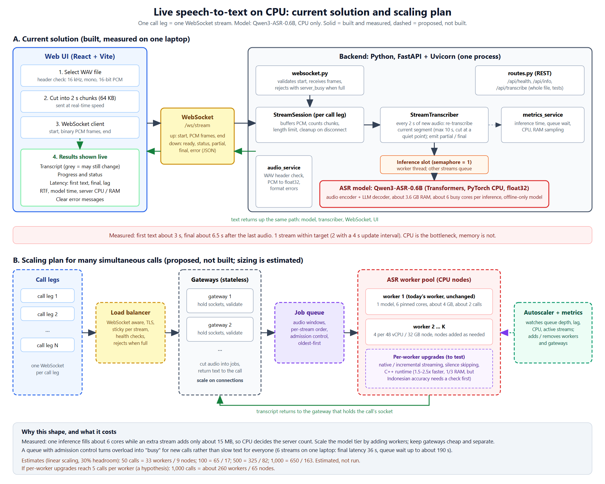

# Architecture: current solution and scaling plan

Source: [architecture_updated.svg](architecture_updated.svg). Solid boxes are built and measured; dashed boxes are proposed and not built.

## A. Current solution

One browser tab acts as **one call leg**: it streams a WAV file to a Python backend, which transcribes it with Qwen3-ASR-0.6B on the CPU and sends text back while the audio is still arriving.

### Data flow
1. **Select file.** The UI checks the WAV header (16 kHz, mono, 16-bit PCM) and rejects anything else with an ffmpeg hint.
2. **Chunk.** The audio is cut into 2 s chunks (64 KB) and sent at real-time speed, as a live call would produce it.
3. **WebSocket `/ws/stream`.** Client sends a JSON `start`, then binary PCM frames, then `end`. Server answers with JSON `ready`, `status`, `partial`, `final` or `error`.
4. **Backend (FastAPI + Uvicorn, one process).**
   - `websocket.py` validates the start message, receives frames and returns `server_busy` when the stream cap is reached.
   - `StreamSession` holds the state of one call leg: buffered PCM, counters, length limit, cleanup on disconnect.
   - `StreamTranscriber` runs every 2 s of new audio. It re-transcribes the current segment (partial text, may change). A segment is committed at a quiet point once it reaches 10 s, and a final pass runs at the end.
   - An **inference slot** (semaphore = 1) lets one inference run at a time in a worker thread. One inference already uses about 6 cores, so more at once only causes contention. Other streams wait.
   - `audio_service` converts and checks audio. `metrics_service` records inference time, queue wait, CPU and RAM.
   - `routes.py` offers `/api/health`, `/api/info` and `/api/transcribe` (whole file, for testing).
5. **Model.** Qwen3-ASR-0.6B through Hugging Face Transformers, PyTorch CPU, float32. About 3.6 GB RAM.
6. **Return path.** Text goes back model, transcriber, WebSocket, UI. The UI shows the transcript (grey = may still change), progress, first-text and final latency, real-time factor and server CPU / RAM.

### Important limitation
The Transformers model is offline-only, so streaming is **application-level**: the same recent audio is transcribed repeatedly. This costs about 2.5-3x the compute of one offline pass, and it is the main reason capacity is low.

### Measured on one laptop (i5-10500H, 6 cores / 12 threads, 24 GB)
| Result | Value |
|---|---|
| First text after stream start | about 3 s |
| Final text after last audio | about 6.5 s |
| CPU per stream | about 6 busy cores |
| RAM | 3.8 GB, each extra stream about 15 MB |
| Capacity | 1 stream with default settings, 2 with a 4 s update interval |

CPU is the bottleneck, not memory. At 6 streams nothing failed but final latency reached about 36 s.

## B. Scaling plan (proposed, not built)

For many simultaneous calls, the layers are separated so each scales on its own signal:

| Layer | Role | Scale on |
|---|---|---|
| **Load balancer** | WebSocket aware, TLS, sticky per stream, health checks, rejects when full | traffic |
| **Gateways** (stateless) | Hold the sockets, validate, cut audio into jobs, return text to the right call | number of connections |
| **Job queue** | Audio windows, per-stream ordering, oldest-first, admission control | (buffers load) |
| **ASR worker pool** | Each worker = 1 model process, 6 pinned cores, about 4 GB, about 2 calls. 4 workers per 48 vCPU / 32 GB node | queue wait / lag |
| **Autoscaler + metrics** | Watches queue depth, lag, CPU, active streams; adds or removes workers and gateways | n/a |

### Why this design
- **Inference is the expensive part.** Gateways are cheap, workers are not. Splitting them avoids paying for model capacity just to hold sockets.
- **Admission control.** Without it, overload makes everyone slow (queue wait grew to about 190 s at 6 streams). With it, new calls get "busy" and existing calls stay within the latency target.
- **Memory is not the constraint.** Per-stream memory is tiny, so adding workers (CPU) is the scaling lever.

### Per-worker upgrades (to test, not measured)
Fewer servers are needed if each worker handles more calls:
- Native or incremental streaming, to remove the repeated re-transcription.
- Silence skipping.
- A C++ runtime. Measured offline: transcribe.cpp (Q5_K_M) was 1.5-2.5x faster with about a third of the RAM (1.2-1.3 GB vs 3.6-3.8 GB), but Indonesian WER was worse (0.602 vs 0.442), so accuracy must be checked first. Streaming was not tested.

### Sizing (estimated, not run)
Assumptions: 1 worker serves 2 calls (best measured result), 30% headroom, linear scaling.

| Call legs | Workers | vCPU | RAM | Nodes (48 vCPU / 32 GB) |
|---:|---:|---:|---:|---:|
| 50 | 33 | 396 | 132 GB | 9 |
| 100 | 65 | 780 | 260 GB | 17 |
| 500 | 325 | 3,900 | 1,300 GB | 82 |
| 1,000 | 650 | 7,800 | 2,600 GB | 163 |

If upgrades reach 5 calls per worker (a hypothesis, not a result), 1,000 calls need about 260 workers / 65 nodes. Linear scaling is probably optimistic. Details and assumptions: [../reports/capacity_estimates.md](../reports/capacity_estimates.md).

## What changed from the earlier diagrams
- `architecture.png` and `scaling.png` are merged into one picture, with built and proposed parts marked differently.
- Added: the `server_busy` rejection, the metrics service link, an autoscaler, the per-worker upgrade path based on the C++ runtime results, and a sizing summary.
